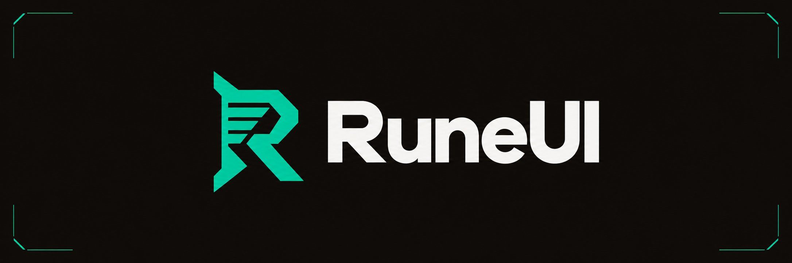

# RuneUI

A clean combat HUD for RuneScape 3. RuneUI draws compact unit frames, a resource bar, a cast bar, groups of ability cooldowns and rows of buffs and debuffs in one block below your character: Major on top, Rotation under it with a frame either side, then the adrenaline and cast bars, Utility and Defensives, so the numbers you check mid-fight sit close together. Game windows such as the bank draw over it.

## What it shows

- The player frame shows your name and lifepoints as "13.1K | 78%" on a health bar, with a thin prayer bar underneath.
- The target frame shows your target's name and lifepoints as "6,800 | 58%".
- The resource bar fills with your adrenaline and shows its percent, with two markers you can set, such as 50% and 100%. Each marker is a faint line across the bar, light above your adrenaline and dark once it reaches the marker. With a Necromancy weapon it adds rows of blocks for residual souls and necrosis stacks, below the bar by default. **Spenders** on the Bars page moves them above the bar or under the player frame, and whatever is anchored to that element moves to make room. With no spenders, as on Magic, they take no space. The soul row grows to 5 blocks while a Soulbound lantern is worn. Blocks that make a whole cast turn gold: the soul row once it is full, and necrosis in sixes, so 8 necrosis shows 6 gold blocks and 2 purple.
- The cast bar under the resource bar shows the ability you are channelling, such as Asphyxiate or Rapid Fire, with its icon, name and seconds left, filling smoothly between game ticks in its combat style's colour: blue for Magic, green for Ranged, red for Melee and purple for Necromancy, unless you pick another colour on the Bars page. A white spark leads the fill, and its glow flashes on each game tick as the game's own spark does. It starts, counts down and ends with the game's own cast bar, showing the same time. A faint line across the bar marks each hit that lands partway through, and turns dark once the fill passes it, so you can see how many hits you keep if you cut the channel short. A channel you cut short shows "Cancelled", as the game's bar does, then fades out. It is empty between channels.
- The Major, Rotation and Utility groups and the Defensives group hold ability icons. Defensives is the first of up to four groups of your own, which you can rename or delete. Each icon shows its action bar keybind, and dims and counts down in whole seconds while cooling, changing on each real second instead of with the 0.6 second game tick. An icon turns dark with a faded keybind while its ability can't be cast, as it does on the action bar, such as when you lack the adrenaline. Surge and Escape show their charges left at bottom left and stay ready while one is left, with a white bar along the bottom filling as the next charge returns. Spectral Scythe and Dismember count down each stage's short lockout, then show the open stage, such as 2/3, until the last stage starts the full cooldown. Volley of Souls shows your residual souls and Finger of Death your necrosis, as a count over a bar in the spender row's colour. The stacks that make a whole cast turn gold and the bar thickens, and Finger of Death's bar has a white notch at 6. Hover an icon to see its name, cooldown length, keybind, the ability's description from the game data and its ready state. A group wraps onto a new row or column once it holds its set number of icons, and each row grows from its center.

- Four aura rows show the icons from the game's buff bar, debuff bar and target panel. Target debuffs sit above the target frame and your debuffs above the player frame, both with an orange edge. The debuff rows show only debuffs worth acting on: on the target, the ones you apply, such as Vulnerability, Death Mark, Bloated, Haunted and bleeds; on you, stuns, binds, poison, adrenaline drains and boss mechanics. Stun Immune on training dummies stays off. Long buffs such as overloads and prayer renewals sit below the player frame, and short combat buffs such as ultimates sit above the resource bar. Each icon shows its time left as the game's own label does, and its stacks in the top right. In its last 10%, or its last 3 seconds when that is longer, an icon gets a white ring. An icon whose number holds steady, such as Bloodlust's stacks, shows it as a count with no ring. Hover an icon to see its name, whether it is a buff, a debuff on you or a debuff on the target, its time left or stacks, and its description from the game data. The first time RuneUI sees an icon, it shows a name taken from the icon until the game's own name and description load, within about a minute.

A buff joins a row the first time RuneUI sees it: the combat row if it has a minute or less left, the long buff row if it has more, and no row if it has no timer, such as a percent. Target debuffs show no timer, because the game's target panel does not show one.

Each combat style has its own Major and Rotation groups, and RuneUI shows the ones for the weapon in your main hand, switching when you change weapons. The groups start with the cooldowns most PvM setups track. Major holds each style's big damage cooldowns: Living Death and Death Skulls; Sunshine, Tsunami, Omnipower and Metamorphosis; Death's Swiftness, Deadshot, Unload and Shadow Tendrils; Berserk, Meteor Strike, Overpower and Massacre. Rotation holds six core abilities per style, such as Soul Sap, Touch of Death and Volley of Souls on Necromancy, Concentrated Blast, Sonic Wave and Wild Magic on Magic, Rapid Fire, Snap Shot and Bombardment on Ranged, and Assault, Hurricane and Destroy on Melee. Utility holds Dive, Surge, Escape and your weapon's special attack, and Defensives holds Freedom, Anticipation, Resonance, Devotion, Barricade, Reflect, Debilitate and Immortality. Both show the same abilities for every style. An icon shows its keybind once the ability is on your action bar. A style that already holds abilities, such as one carried over from an older version, keeps them. You can rearrange every group yourself in the options window.

## Install

RuneUI runs on the RuneScape beta while plugins are in testing.

1. Copy the `runeui` folder into `dev_plugins` in the beta client's folder, such as `C:\ProgramData\Jagex\RuneScape-BETA\dev_plugins\runeui` on Windows or `~/Jagex/RuneScape-BETA/dev_plugins/runeui` on macOS. Create `dev_plugins` if it does not exist.
2. Log in to the beta and open the console with Alt and the key under Esc.
3. Run `prf` to refresh the plugin list, then `pon runeui` to turn RuneUI on.

## Options

Open the plugin ribbon and press **Open RuneUI options**. The window opens on Appearance, the first page in its menu, followed by Cooldown manager, Buffs and Bars. Press Esc or **Done** to close the window.

- The Appearance page shows a preview of the HUD at its top: ability tiles with keybinds, one cooling, an aura with its timer, and the player and target frames, drawn the way the HUD draws them. **Dark**, **Light** and **Game** set the preview's backdrop to black, light lilac, or the game world behind the window. Every change shows on the preview and the HUD at once. The settings below it scroll with the mouse wheel or the bar at the right, in three sections:
  - Text sets the HUD's font, Museo Sans, Noto Sans, Verdana or Cinzel, each option drawn in its own font. **Text size** moves every HUD text by the same number of points, shown as the unit frame text size, 13 pt by default, and each text snaps to the nearest size its font has. **Text edge** picks none, a shadow, an outline, or both. **Text colour** picks white, the game's yellow, or Auto, which draws dark text over a bright fill and white elsewhere. These apply to unit frame names and values, the resource bar percent, the cast bar name and time, cooldown keybinds and seconds, and aura timers and stacks, not to this window, edit mode or tooltips.
  - Unit frames sets **Player colour** and **Target colour** from named presets, each drawn in its colour with its name on it: RuneUI's own blue or orange, Game green, Game red, Magic, Ranged, Melee, Necro, and Equipped, which follows your main-hand weapon's combat style. **Custom** opens a shade square and hue strip to pick any colour. The field beside the presets shows the colour as a hex code and takes a typed `#RRGGBB`. The chosen preset has a white ring. The section also sets the bar fill, flat or a vertical or horizontal gradient, and the frame border: RuneUI's 1 px black edge, the game's own thin window border, as round its action bars, or none. **Lifepoints text** picks 12.2K | 78%, 12,242 / 15,695, 12.2K or 78% for both frames. The target frame has no maximum to show, so its full format reads 12,242 | 78%. **Frame width** runs from 180 to 400 px and **Frame height** from 30 to 80 px, both frames alike, and anchored elements keep their gaps when a frame changes size.
  - Game interfaces can hide the game's own target panel, since RuneUI's target frame replaces it. **Game cast bar** hides the game's own cast bar, which it does until you choose Show, since RuneUI draws its own.
- The Cooldown manager page opens on your weapon's combat style, marked Equipped, with tabs for the other styles. Pick a group from the list on the left to set its icon size, how many icons fit in a row or column before it wraps, which way it grows, and whether its abilities change with the style or stay the same for every style. Drag an icon to reorder it, press **+** to add an ability, and click an icon for a Remove option. The **+** list opens on the style you are editing and closes with its X, Esc or a click elsewhere in the window, with tabs for the others and a search box for ability names, and choosing an ability from another group moves it here. It lists the preset abilities and any other ability you have used, and when they run past its last row, that row says how many more the search box can find. **New group** adds a group of your own, up to four, which you can rename. Its **Delete** button asks for a second click.
- The Buffs page lists every buff and debuff RuneUI has seen, in the tabs Buffs on you, Debuffs on you, Debuffs you inflict and Display. Buffs sit in Combat buffs, Upkeep buffs or Hidden, and each debuff tab splits its debuffs into Tracked and Not tracked; only tracked debuffs show on the HUD. Drag an icon onto another to swap the two, or between two icons to insert it there, within a group or into another, as in the Cooldown manager. Each HUD row shows its icons in this order. Click an icon for a menu that moves it to the end of another group. Hover an icon for its name. An upkeep buff's menu also has **Keep up**: while a Keep up buff is missing and you have a target, its icon keeps its place in the upkeep row, dim inside a dashed white outline with no time, so a dropped overload shows. Kept up buffs carry a white K on the page.
- Each Buffs page tab has a **Find** button that searches the game's effects of the tab's kind, not only those RuneUI has seen. Buffs on you lists All, General, Prayers, Curses and Abilities, then bosses whose fights give you a buff. Debuffs on you lists General and the bosses, and a boss lists its own effects and the common ones it applies, such as Telos's stun, with the ability that applies it. Debuffs you inflict lists the debuffs your abilities, spells and items put on a target, grouped by combat style as Magic, Ranged, Melee, Necromancy, Any style and Weapons and items, each with what inflicts it. Each group shows a count. Typing matches effect, group and cause names. **Track** adds an effect to the tab's Tracked group, or to Combat buffs, so its icon shows on the HUD the first time the game shows it; **Tracked** removes it. The search closes with its X, Esc or a click elsewhere in the window.
- The Buffs page's Display tab holds **Game buff bars**, which hides the game's own buff and debuff bars since RuneUI's aura rows replace them, and **Aura icons**, which picks plain icons or icons with a draining bar under each. With bars, an icon in its last 10% gets a dashed white outline and a striped bar instead of the ring.
- The Bars page has the same preview strip, showing the adrenaline bar and the cast bar. **Adrenaline bar** sets the threshold and ultimate marker percents, **Bar width**, 120 to 500 px, and **Bar height**, 12 to 40 px, and **Spenders**, which puts the spender rows below the bar, above it, or under the player frame. **Cast bar** sets **Width from**, its own width or the adrenaline bar's, **Width**, 150 to 500 px, and **Height**, 14 to 40 px, with the icon growing to the bar's height. **Colour** picks Ability style, which keeps each channel in its combat style's colour, RuneUI's teal, Game green, Game red, Magic, Ranged, Melee, Necro, Custom or a typed `#RRGGBB`. **Font** and **Text size** start on Match HUD, so the cast bar's name and time follow the Appearance text settings until you pick its own font or size.
- The Bars page's **Action bars** table fades the game's own action bars for players who rarely look at them. Each bar, the main bar and action bars 2 to 5, has **Fade**, an **Opacity** from 0 to 100% in steps of 5, 25% by default, and **Show on hover**, which shows the bar at full while the mouse is over it. A faded bar draws its icons, keybinds, cooldown seconds and window frame at that opacity, and hides its slot borders, ready flash, queue circle and hover highlight. At 0% its keybinds hide too. Keybinds, clicks, the ability queue and cooldowns keep working.
- Every number setting has **-** and **+** buttons that step it by 1, and its number is a field you can type in. A number is saved once it is in range, and Enter, Esc or clicking away saves the nearest allowed value.
- Edit mode, turned on from the checkbox in the window's footer, lets you drag any HUD element to move it. Everything anchored to that element moves with it. Press Esc to finish, or **Done** to return to the window.
- To anchor an element, press its **Anchor** button in edit mode, click another element, then choose a side and alignment from the menu. The element sits flush against that side and keeps its gap when the other element grows or shrinks, such as when a group gains an icon. Its button then names the anchor, such as "Major, left, top", and pressing it removes the anchor. Everything starts anchored to the resource bar, directly or through the elements below it, so dragging the bar moves the whole HUD.
- While you drag, an element snaps to the edges and centers of other elements and of the game window, or to a 16 px grid, and a line marks each snap. Hold Shift to move freely. **Snap on** in the toolbar turns snapping and the grid off. **Reset positions** asks first, then puts every element and anchor back.

RuneUI saves your layout, groups, markers and appearance and keeps them between sessions. Updating to this version puts every element back in the new default layout once, and keeps your abilities in their groups.

## What RuneUI reads and does

RuneUI only displays information the game already shows you. It reads your lifepoints, prayer, adrenaline, stacks and cooldowns from the game, along with the icons and keybinds on your action bars and whether each one is dimmed, the icons and time labels on the game's buff and debuff bars, the game's own target panel, your worn equipment and its main-hand attack type, and the ability you are channelling with its start and end tick and how many times it hits. Ability, buff and debuff names and descriptions come from the game's own data, the same text its tooltips show. The Buffs page search lists the game's buff and debuff data, grouped by the boss that uses each one or the combat style that inflicts it; it never says when a boss will use one. Until RuneUI has looked up an icon's name, or when the game data has no name for it, it shows one built from the icon's name in the game data. RuneUI saves which row each buff joined, which debuffs you track, which buffs you keep up and the order you sort them in.

It never clicks, casts or sends anything to the game on your behalf. It needs no permissions and sends no data off your computer.

Hiding the game's target panel makes it fully transparent rather than closing it, because RuneUI reads the target's name and debuffs from it. Hiding the game's buff bars hides each icon and makes the rest of the bars fully transparent, because RuneUI reads the time labels from them. Hiding the game's cast bar makes it fully transparent too, so the game keeps showing and hiding it as it would, and hides the glow on its moving spark, which the game keeps fading back in. Fading an action bar sets each of its parts to a share of the opacity the game gives it, and fades it again when the game resets a keybind or rebuilds its stat bars after a window resize. Turning any of these options back off, reloading RuneUI or turning it off restores the game's interfaces.

## Development

Specs use [busted](https://lunarmodules.github.io/busted/) and linting uses [luacheck](https://github.com/lunarmodules/luacheck), both installed with LuaRocks for Lua 5.4. [StyLua](https://github.com/JohnnyMorganz/StyLua) formats the code. From the repo root:

```sh
busted
luacheck .
for f in main.lua src/*.lua spec/*.lua spec/support/*.lua; do luac5.4 -p "$f"; done
stylua --check main.lua src spec
```

After saving a change, run `prl runeui` in the game console to reload the plugin.

`src/adapter.lua` is the only module that reads the game client. `src/frames.lua`, `src/cooldowns.lua`, `src/channel.lua`, `src/auras.lua`, `src/auralists.lua`, `src/settings.lua`, `src/editor.lua`, `src/layout.lua`, `src/icons.lua` and `src/search.lua` are pure Lua with specs. `src/presets.lua` holds the abilities each group starts with, and `src/catalog.lua`, generated by `tools/catalog.lua`, every buff and debuff the search lists. `src/view.lua`, `src/options.lua`, `src/buffspage.lua`, `src/aurasearch.lua` and `src/editmode.lua` draw the HUD, the options window, its Buffs page, the Buffs page search and edit mode. `src/dragdrop.lua` drags icons in the options window.

## Contributing

Bug reports and pull requests are welcome. Read [CONTRIBUTING.md](CONTRIBUTING.md) first, and follow the [code of conduct](CODE_OF_CONDUCT.md).

## License

RuneUI is released under the [MIT licence](LICENSE).

RuneScape is a trademark of Jagex Ltd. RuneUI is a fan-made plugin and is not affiliated with or endorsed by Jagex.
