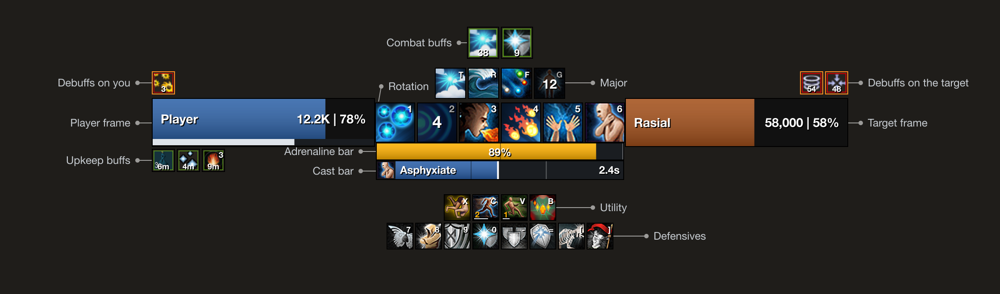

# RuneUI

A combat HUD for RuneScape 3. It draws your frames, bars, cooldowns and buffs in one block below your character, so everything you check mid-fight sits together.

## What it shows

- Player and target frames with name, lifepoints and a prayer bar.
- The adrenaline bar with two markers you set, and rows of residual souls and necrosis stacks on Necromancy. After each cast a thin gold strip on the side facing your cooldown icons fills across the 1.8 s global cooldown, so you can see when the next ability will go off.
- A cast bar for channels such as Asphyxiate, with a mark for each hit and the same time as the game's own.
- Cooldown groups: Major, Rotation, Utility and Defensives. Each icon shows its keybind and seconds left, and Major and Rotation change with your weapon's combat style. The ability you have queued gets a gold border with a light that runs round it once a tick.
- Aura rows: combat buffs, upkeep buffs, debuffs on you and debuffs on your target. Each icon shows its time or stacks and gets a ring in its last seconds.
- Party frames: a grid with one cell per group member, showing their name, lifepoints, the tag you gave them and the leader's icon. The grid resizes for a duo, a party of 3 to 5, a large group of 6 to 7 and a raid of 8 or more. A cell gets a white border under 30% lifepoints and a dashed one at 0, and dims when its member is out of view. Lifepoints come from the game's group window, so they show only while it is open.
- A group sidebar: the game's group window buttons as a narrow column, in RuneUI's style. It starts on the left edge of the screen and edit mode moves it. Every click lands on the game's own button. The arrow tab on its edge folds it to a thin bar and back. Its **Roles** button opens the options on the Party page.
- Game window frames recoloured to match: every window's border and background take a colour you pick, blue and dark grey to start, and every window's background can fade, all together or each on its own, such as chat over the world.
- Names over players' heads, off until you turn them on in Style. A friend, someone in your clan chat or friends chat, and a guest in your clan chat each get the colour you gave that chat in the game's settings, with private chat's colour for a friend, or yellow, orange, blue and pink when RuneUI cannot read it. Names stay off while you are opted into Wilderness PvP.

Hover anything for its name and description. Every element can be moved, anchored to another and resized. The HUD hides while the world map is open, and can fade or hide out of combat. The party frames and the group sidebar stay at full out of combat.

## Install

RuneUI runs on the RuneScape beta while plugins are in testing, and needs PrettyUI for its options window.

1. In the beta, open the plugin hub and install PrettyUI.
2. Copy the `runeui` folder into `dev_plugins` next to the beta client: `C:\ProgramData\Jagex\RuneScape-BETA\dev_plugins\runeui` on Windows, or `~/Jagex/RuneScape-BETA/dev_plugins/runeui` on macOS.
3. Open the console with Alt and the key under Esc, then run `prf` and `pon runeui`.

"Missing dependency 6398181" means PrettyUI is not installed. Install it from the hub or restart the client.

## Options

Open the plugin ribbon, choose RuneUI and press **Options**. The list down the left holds the RuneUI HUD pages, then the Game interfaces pages. Under **Options**, the **Out of combat** and **Action bar fading** checkboxes turn out of combat fading and action bar fading on or off in one click, such as while skilling, and keep the rest of your settings for when you turn them back on.

- Style sets fonts, text size and edge, frame colours and sizes, the bar texture, whether each player's name shows over their head, and how the HUD shows out of combat: at full, faded to an opacity you set, or hidden. It comes back at full in combat, while you have a target unless you turn that off, and while the options window or edit mode is open. A preview at the top shows every change.
- Cooldown manager sets each group's icon size, wrapping and direction, and its abilities per combat style. Drag icons to reorder them, press **+** to add one and click one to remove it.
- Buffs sets which row each buff shows in, which debuffs you track, and **Keep up** for buffs you never want to drop. **Find** searches every effect in the game by name or boss.
- Bars sets the adrenaline markers, bar sizes, and the cast bar's colour and font.
- Party gives each group member a tag of up to 10 characters, with **Base tank** as a one-click gold tag. A cell shows as much of a long tag as fits in half its width, and its hover shows the whole tag. A tag is that player's default in every group. A role preset, such as one per boss, holds its own tags that override the defaults while it is chosen. A right click on a member, on their party cell or their row in the game's group window, adds **Set role** under the game's own entries. It opens a small picker beside their cell: type a tag, or click Base tank, None or one of the tags listed for Amascut, Durzag, Yakamaru, Angel of Death and Vorago. The page also sets how the grid fills, by rows or by columns, and which way it grows, and for each group size the cell width and height, the most cells in a row or column and whether your own frame shows. **Group sidebar** turns the sidebar on or off. The sidebar leaves out the window's **Show group** and **Show banned list** tabs, so turn it off to reach the banned list. With it on, the party grid and the sidebar stand in for the game's group window while that window is open: the window is not seen, each member row's click area sits under that member's cell and each of the window's buttons under its tile in the sidebar. A click, right click or hover on a cell is then one on the game's own row, and clicks beside the cells and the sidebar go through to the world. The unseen window spans only the cells, and reaches the sidebar only while the cursor is on the sidebar's buttons. The grid and the sidebar sit where edit mode puts them. Close the group window and the cells keep their names and tags, show no lifepoints and take no clicks.
- Windows sets the colour of every game window's frame and background, from a preset, **Game** for the game's own look, or any colour from **Custom**. **All windows** sets every window's background opacity in steps of 5%, and **Add window** searches the game's windows to give one its own, such as clan chat clear while the rest stay solid. The background and the tab strip fade, the tab strip halfway as with the game's own chat transparency; the window's text, icons and border stay solid. The game's chat transparency still applies under RuneUI's.
- Action bars fades the game's action bars, each to its own opacity, with one switch over all of them.
- Hidden interfaces hides the game's own target panel, cast bar and buff bars while RuneUI shows them.
- Edit mode lets you drag any element, anchor it to another from its **Anchor** button and snap to edges or a grid. Hold Shift to move freely.

Settings save between sessions.

## What it reads

RuneUI only shows what the game already tells you: your stats, cooldowns and action bars, the game's buff bars and target panel, and ability and effect names from the game's own data. For other players it reads three things: the names, lifepoints and leader that the game's group window lists for your group, the names and positions of the players in view, and the names on your friends list and in your friends chat and clan chat lists, with the colours you set for those chats. The players in view dim a group member who is not among them and, with names turned on, get their name drawn over their head, coloured when one of those lists holds it. Tags and presets are your own notes and stay on your computer. A right click on a group member's row gets one entry of RuneUI's own, Set role, which only opens RuneUI's picker. The one addition is a countdown on debuffs you put on your target, timed from the length the ability or spell's own description gives. Each target keeps its countdowns while you look at another, though RuneUI cannot see a debuff renewed on a target you are not looking at. It never sends input, needs no permissions and sends nothing off your computer. Hiding a game interface makes it transparent, and recolouring or fading a window changes only its frame's colour and background opacity. Turning the option off, reloading or disabling RuneUI restores each. The group sidebar makes the group window transparent, sizes it round the party cells and the sidebar, moves its row click areas and buttons and changes which of its parts stop a click, and turning it off or disabling RuneUI puts them back.

## Development

Specs run with busted, linting with luacheck and formatting with StyLua, all on Lua 5.4:

```sh
busted
luacheck .
for f in main.lua src/*.lua spec/*.lua spec/support/*.lua; do luac5.4 -p "$f"; done
stylua --check main.lua src spec
```

Run `prl runeui` in the game console to reload after a change. [CONTRIBUTING.md](CONTRIBUTING.md) explains how the code fits together.

## License

MIT. See [LICENSE](LICENSE).

RuneScape is a trademark of Jagex Ltd. RuneUI is a fan-made plugin, not affiliated with or endorsed by Jagex. The ability and status icons in the mock above are Jagex's, from the [RuneScape Wiki](https://runescape.wiki).
