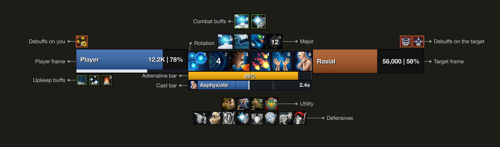

# RuneUI

A combat HUD for RuneScape 3. It draws your frames, bars, cooldowns and buffs in one block below your character, so everything you check mid-fight sits together.



## What it shows

- Player and target frames with name, lifepoints and a prayer bar.
- The adrenaline bar with two markers you set, and rows of residual souls and necrosis stacks on Necromancy.
- A cast bar for channels such as Asphyxiate, with a mark for each hit and the same time as the game's own.
- Cooldown groups: Major, Rotation, Utility and Defensives. Each icon shows its keybind and seconds left, and Major and Rotation change with your weapon's combat style.
- Aura rows: combat buffs, upkeep buffs, debuffs on you and debuffs on your target. Each icon shows its time or stacks and gets a ring in its last seconds.

Hover anything for its name and description. Every element can be moved, anchored to another and resized. The HUD hides while the world map is open, and can fade or hide out of combat.

## Install

RuneUI runs on the RuneScape beta while plugins are in testing, and needs PrettyUI for its options window.

1. In the beta, open the plugin hub and install PrettyUI.
2. Copy the `runeui` folder into `dev_plugins` next to the beta client: `C:\ProgramData\Jagex\RuneScape-BETA\dev_plugins\runeui` on Windows, or `~/Jagex/RuneScape-BETA/dev_plugins/runeui` on macOS.
3. Open the console with Alt and the key under Esc, then run `prf` and `pon runeui`.

"Missing dependency 6398181" means PrettyUI is not installed. Install it from the hub or restart the client.

## Options

Open the plugin ribbon, choose RuneUI and press **Options**.

- Appearance sets fonts, text size and edge, frame colours and sizes, the bar texture, whether the game's own target panel and cast bar stay visible, and how the HUD shows out of combat: at full, faded to an opacity you set, or hidden. It comes back at full in combat, while you have a target unless you turn that off, and while the options window or edit mode is open. A preview at the top shows every change.
- Cooldown manager sets each group's icon size, wrapping and direction, and its abilities per combat style. Drag icons to reorder them, press **+** to add one and click one to remove it.
- Buffs sets which row each buff shows in, which debuffs you track, and **Keep up** for buffs you never want to drop. **Find** searches every effect in the game by name or boss.
- Bars sets the adrenaline markers, bar sizes, the cast bar's colour and font, and fades the game's action bars.
- Edit mode lets you drag any element, anchor it to another from its **Anchor** button and snap to edges or a grid. Hold Shift to move freely.

Settings save between sessions.

## What it reads

RuneUI only shows what the game already tells you: your stats, cooldowns and action bars, the game's buff bars and target panel, and ability and effect names from the game's own data. The one addition is a countdown on debuffs you put on your target, timed from their known length. It never sends input, needs no permissions and sends nothing off your computer. Hiding a game interface makes it transparent, and turning the option off, reloading or disabling RuneUI restores it.

## Development

Specs run with busted, linting with luacheck and formatting with StyLua, all on Lua 5.4:

```sh
busted
luacheck .
for f in main.lua src/*.lua spec/*.lua spec/support/*.lua tools/*.lua; do luac5.4 -p "$f"; done
stylua --check main.lua src spec tools
```

Run `prl runeui` in the game console to reload after a change. [CONTRIBUTING.md](CONTRIBUTING.md) explains how the code fits together.

## License

MIT. See [LICENSE](LICENSE).

RuneScape is a trademark of Jagex Ltd. RuneUI is a fan-made plugin, not affiliated with or endorsed by Jagex. The ability and status icons in the mock above are Jagex's, from the [RuneScape Wiki](https://runescape.wiki).
